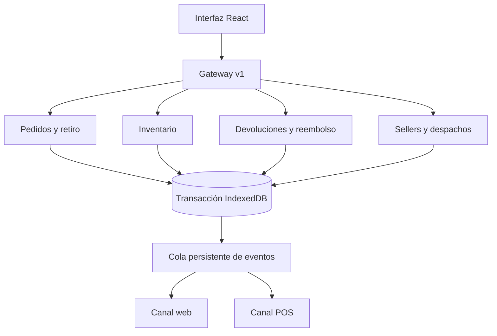

# Omni-SI Falabella

Web responsiva del proyecto académico SIE Proyect para el punto 8 del APF3. Los tres sprints usan React en el navegador. Vite ejecuta el servidor de desarrollo y compila la aplicación estática.

## Entrega del punto 8 del APF3

- [Demostración de los tres sprints](entrega/Omni-SI-Falabella-APF3.zip). Extraer todo el paquete y abrir PRESENTACION.html. Contiene las tres compilaciones React, el contrato del gateway y un guion de exposición. LEEME.txt incluye la opción de servir la carpeta con Python 3 para acceder desde un celular.
- [Documento para el informe grupal](entrega/Punto-8-APF3.docx). Incluye el alcance, los incrementos, las capturas y los resultados de verificación.
- La rama main contiene la entrega final. Las ramas Sprint1, Sprint2 y Sprint3 permiten consultar sus fuentes y comparar incrementos con `git diff Sprint1..Sprint2` y `git diff Sprint2..Sprint3`.

## Ejecutar desde una copia limpia

Versiones probadas: Node.js 26.13.1, npm 11.20.0, React y React DOM 19.3.0, Vite 8.3.4. El proyecto requiere Node.js 22.12 o posterior. Las dependencias están fijadas en el archivo de bloqueo.

```sh
npm ci
npm run dev
```

Abrir la dirección local que imprime Vite. Para probar desde un celular conectado a la misma red de confianza, ejecutar `npm run dev -- --host 0.0.0.0` y abrir la dirección de red que imprime Vite.

## Compilar y verificar

```sh
npm run build
npm run preview
```

El resultado está en `dist/`. Abrir la dirección que imprime la vista previa y comprobar el incremento en celular y en PC. Con acceso al registro de npm, ejecutar `npm audit` para revisar dependencias directas y transitivas.

## Trabajar por sprint

| Rama | Propósito |
| --- | --- |
| main | Entregas aceptadas. |
| dev | Base común e integración de los incrementos revisados. |
| Sprint1 | Inicio y planificación del proyecto. |
| Sprint2 | Modelado de procesos omnicanal y demostración de sus flujos. |
| Sprint3 | Arquitectura e integración. |

Usar `git switch Sprint1`, `git switch Sprint2` o `git switch Sprint3` para abrir una rama. Cada incremento parte del anterior y se conserva en su rama para la exposición. Tras la revisión, integrar en dev. Actualizar las ramas reservadas desde dev antes de continuar su implementación. La fuente académica es APF2, secciones 16, 17 y 21.

## Demo del Sprint 1

En Sprint1, abrir la página inicial. En las versiones posteriores, elegir Planificación. Desplegar «Actividades y responsables del sprint» y comprobar las diez actividades SP1-01 a SP1-10 del APF2 (sección 17.1). Al cerrar el detalle vuelve a quedar visible el resumen. Repetir a 390 y 1280 px de ancho. Las capturas están en [celular](evidencias/celular.png) y [PC](evidencias/pc.png).

## Sprint 2 · Procesos omnicanal

Las nueve pantallas del APF2 (sección 21) se recorren desde Comprar, Mis pedidos, Devoluciones y el menú Equipo de tienda. Los perfiles de cliente, tienda, finanzas y administrador son pasos de una simulación guiada. Usar únicamente documentos y expedientes ficticios. Los datos persisten en IndexedDB por navegador y origen.

| Historia | Recorrido de demostración |
| --- | --- |
| HU01 Compra con retiro | En Comprar, elegir Tienda A, ajustar a 2 unidades y pulsar Reservar para retiro. Confirmar con el documento ficticio 00000001. En Mis pedidos, usar «Abrir este pedido en tienda». Allí iniciar preparación y marcarlo listo. Consultar el código en Seguimiento del pedido y validar código y documento en Entrega. En otro pedido, probar Cancelar y comprobar la liberación de la reserva. |
| HU02 Inventario | Consultar el físico, reservado y disponible por ubicación. Registrar un ingreso, una venta POS o un traslado entre tiendas, revisar el saldo y el historial. La cuarentena se controla por separado. |
| HU03 Devoluciones | Buscar el pedido entregado o PED-DEMO, seleccionar la compra, el motivo, la cantidad y la condición. Registrar y procesar el reembolso simulado. Una unidad dañada va a cuarentena. PED-VENCIDO permite demostrar el rechazo por plazo. |
| HU04 Marketplace | Registrar razón social, RUC ficticio de 11 dígitos y referencia del expediente. Solicitar corrección con una observación, reenviar y aprobar. En Productos y despachos registrar un artículo, aprobar su publicación, simular un pedido y registrar el número de guía. |

Cada tienda parte de existencias de ejemplo. La Tienda A inicia con 10 unidades físicas y 2 reservadas previas. Las compras nuevas reservan existencias hasta la entrega. El plazo ilustrativo de retiro es de 48 horas y el de devolución de 30 días. El aviso de retiro, los pagos, las referencias a documentos y los despachos son simulados. Las pestañas del mismo origen comparten el estado. Para iniciar otro ensayo independiente se puede usar un perfil de navegador nuevo.

Para probar las reglas de negocio ejecutar `npm test`. Para revisar la interfaz, repetir los recorridos a 390 y 1280 px y comprobar que el estado persiste al recargar.

## Sprint 3 · Arquitectura e integración

En **Equipo de tienda → Comprobar los canales** se muestran las existencias proyectadas en Web y POS, el estado de la cola y la correlación de cada evento. El gateway se ejecuta dentro del navegador usando Request y Response y publica su [contrato OpenAPI v1](public/contrato-v1.json). Las ventas y reservas actualizan una base transaccional de demostración. Los canales Web y POS son consumidores simulados. Dos dispositivos mantienen bases independientes. Entre pestañas del mismo origen se usa IndexedDB y BroadcastChannel.



1. En **Comprobar los canales**, leer el estado integrado y desconectar POS.
2. Registrar una venta POS de prueba. El canal web muestra una unidad menos. El canal POS conserva la proyección anterior. Tras tres intentos, el primer mensaje bloqueado se marca como fallido.
3. Pulsar **Repetir última solicitud**. La respuesta 200 devuelve la misma operación con `repetida: true`. El stock y el número de eventos se conservan. Conservar la correlación para buscar la misma operación en la traza.
4. Reconectar POS y pulsar **Reintentar POS**. Los mensajes vuelven a procesarse en orden y ambas proyecciones coinciden. El cursor evita aplicar secuencias antiguas.
5. Descargar el contrato desde el monitor. La consulta del estado y las once operaciones declaran sus entradas, respuestas y errores. Una clave reutilizada con otro cuerpo devuelve 409, y una regla de negocio incumplida devuelve 422.

Las operaciones y sus eventos se guardan en una transacción. Los eventos anteriores del Sprint 2 quedan en el historial de negocio; al abrir una base existente, los canales se inicializan con el estado vigente. El historial del monitor comienza en ese momento.

### Validación y entrega

Desde la rama del incremento, ejecutar `npm ci`, `npm test` y `npm run build`. Servir `dist/` con `npm run preview`, probar los cuatro recorridos del Sprint 2 y la interrupción y recuperación del Sprint 3. Integrar la rama verificada en dev y promover el commit final a main. El prototipo admite publicación como archivos estáticos en un mismo origen. La rama Sprint1 documenta el incremento inicial y Sprint2 conserva los procesos antes de integrar el gateway.
